<p align="center">
  
</p>

<p align="center">
  <b>A shared trip pot that settles up by itself.</b><br/>
  Friends from different countries put dollars into one pot, spend it with a passkey (Face ID, fingerprint or PIN), and on the trip's last day a smart contract on Monad works out who owes whom and pays everyone back.
</p>

<p align="center">
  <a href="#-demo-videos">Demo videos</a> ·
  <a href="#-who-its-for">Who it's for</a> ·
  <a href="#-try-it">Try it</a> ·
  <a href="#-how-it-works">How it works</a> ·
  <a href="#-sponsor-integrations">Sponsor integrations</a> ·
  <a href="#-live-on-monad-testnet">Live on testnet</a> ·
  <a href="#-architecture">Architecture</a> ·
  <a href="#-testing-with-real-people">User testing</a> ·
  <a href="#-team">Team</a>
</p>

<p align="center">
  
  
  
  
  
  
</p>

<p align="center">
  
  <br/><sub>Real screens from the app in demo mode. Each one is also in <a href="docs/assets/screens/">docs/assets/screens</a>.</sub>
</p>

---

## ⚡ The 30-second pitch

**The problem.** Rina (Indonesia), Wei (Singapore) and Jack (Australia) go to Japan together. Splitwise only *records* who owes whom. They still have to settle with three bank transfers across three countries, each slow, with fees and an exchange-rate loss. Local e-wallets don't cross borders. Crypto apps do, but they ask for seed phrases and gas tokens.

**Tekosue.** One pot for the whole trip:

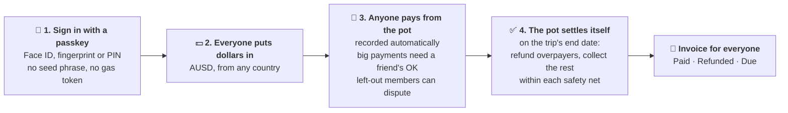

**Why it only works on-chain.** The money and the settle-up logic live in a contract, not with us. No one holds the funds, settlement is final in seconds, and everyone uses the same digital dollar, so there's no FX loss between friends. Monad makes this cheap and fast enough to feel like a normal payment app.

| | Splitwise | Local e-wallet | Bank transfer | **Tekosue** |
| --- | :---: | :---: | :---: | :---: |
| Tracks group spending | ✅ | Partly | ❌ | ✅ |
| Moves real money | ❌ IOUs only | One country | ✅ | ✅ |
| Works across borders | Notes only | ❌ | Slow, fees, FX | ✅ Same dollar for everyone |
| Settles up | Manually | Manually | Days | **Automatically, in seconds** |
| Needs crypto knowledge | No | No | No | **No, just a passkey** |
| Someone holds your money | n/a | Yes | Yes | **No.** The contract holds it, your key stays on your phone |

> **Pitch video:** [youtu.be/2ba0CKPJkk8](https://youtu.be/2ba0CKPJkk8) · **Product demo:** [youtu.be/Va0lA2mHJLw](https://youtu.be/Va0lA2mHJLw) · **Website:** [www.tekosue.xyz](https://www.tekosue.xyz) · **Android APK:** [get the app](https://www.tekosue.xyz/get-app)

---

## 🎬 Demo videos

| Video | Length | What it shows | Link |
| --- | --- | --- | --- |
| **Product demo** | ~3 min | The real app on two Android phones: passkey sign-in, invite link, chip in, pay from the pot with a receipt, the other phone updating within seconds, automatic settle-up, the invoice, and the `GroupVault` contract on the Monad explorer. | _YouTube link_ |
| **Proof of work on Monad** | 43 s | The live website, the app sending a `spend()` transaction, the `GroupVault` contract on testnet.monadvision.com, and six real transactions (create, join, deposit, spend, receipt, settle) read straight from Monad testnet RPC, all `success`. | [▶ Watch on X](https://x.com/tekosuexyz/status/2109873295386722509) |
| **30-second ad** | 30 s | The pitch in 30 seconds, for social. | _X link_ |

The proof-of-work transactions are on the current `GroupVault` ([`0x02Fb…bCE0`](https://testnet.monadvision.com/address/0x02Fb964B6b4470C14D61738EC0a296fa9F2dbCE0)) and anyone can open them on the explorer:
[createGroup](https://testnet.monadvision.com/tx/0xa84a2d83961434afb81703a31747412e8c54e97eda86fc1d394f67d7e4029627) ·
[joinGroupWithPermit](https://testnet.monadvision.com/tx/0xd0ed364d2abe81ba0b9462a6b0b948d56473731a53b4942c118451962f4468d4) ·
[depositWithPermit](https://testnet.monadvision.com/tx/0xe6ded07ac3fb937a225c91f44763dd95274eea43bf14cf20bb442e560d824b9d) ·
[spend](https://testnet.monadvision.com/tx/0x21cc3fea4c31c92d62868c089683678bfe97f20682a42003b317279598b81c17) ·
[attachReceipt](https://testnet.monadvision.com/tx/0xa820161d4119d0f086ff598834d54754d5aacea78eb1b866382716b2c0524084) ·
[settle](https://testnet.monadvision.com/tx/0x83186b88b30b11267f3b57c20e4021ed5ac069f57707526ceb00d4e2e9e06aae).
The videos are built with Remotion in [`video/demo`](video/demo). Follow along on X: [@tekosuexyz](https://x.com/tekosuexyz).

---

## 🎯 Who it's for

**Primary user: a mixed-nationality group of 3 to 10 friends on one shared trip.** They met studying abroad, at work or online, they live in different countries now, and once or twice a year they meet somewhere new. None of them think of themselves as crypto users. Most have never held a stablecoin.

What happens to them today, and what Tekosue changes:

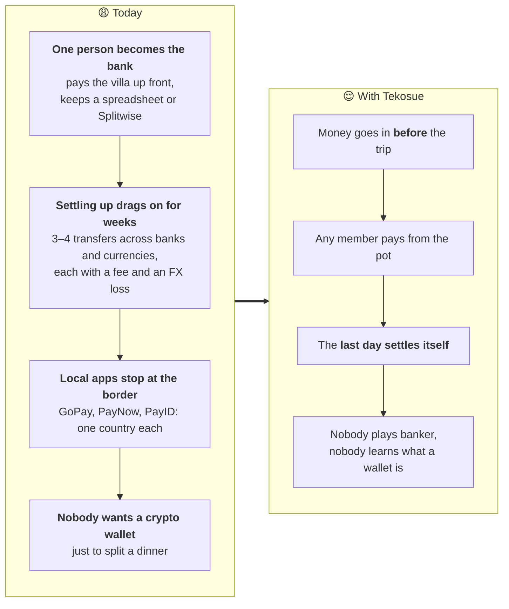

Who comes first, and who comes next:

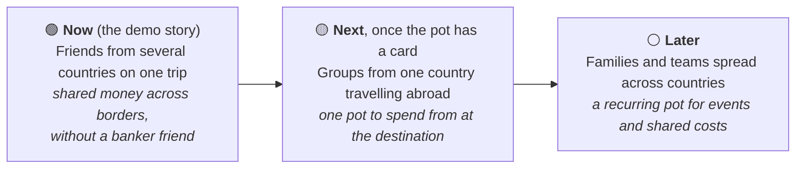

---

## 📱 Try it

The judge path through the app (each screen is a real route in `apps/mobile`):

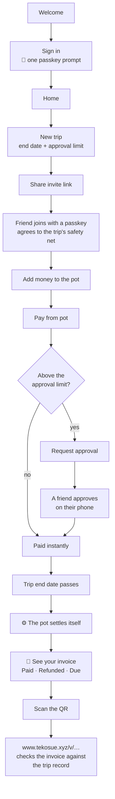

| Step | What you'll see |
| --- | --- |
| **Sign in** | One passkey prompt (Face ID, fingerprint or PIN). The passkey derives the account key on the device (Mera). |
| **New trip / Invite** | Pick an end date and an approval limit, share a link. Friends join with one tap and one passkey confirmation. |
| **Join** | "Join with Passkey" on the invite. The trip creator's **safety net** (the most the trip may pull from you at settle-up) is shown first; joining means you agree to it. One confirmation. |
| **Add money** | Put dollars in the pot whenever you like, one confirmation (no separate "approve"). |
| **Pay from pot** | Amount, who it was for, optional receipt photo. Above the limit → a friend approves on their phone. |
| **Trip** | Live pot balance, activity feed, "who owes whom" preview, all read from the Envio indexer. |
| **Settled** | Each member's invoice with Paid / Refunded / Due, a **Pay** button for debts, PDF export, and a QR code anyone can verify on the web. Someone who still owes sees "You still owe $X" and can't start or join a new trip until it's paid. |
| **Invite link on the web** | `www.tekosue.xyz/j/<code>` shows the real trip (name, members, end date, pot) before the app is installed, then opens the app. |
| **Invoice check on the web** | `www.tekosue.xyz/v/<number>` rebuilds the invoice from the indexed settle-up and says whether it matches. No sign-in needed. |

**If someone doesn't pay.** Whatever a safety net couldn't cover at settle-up stays as a bill on their invoice. Nothing is frozen and the money stays theirs, but until the bill is paid the contract won't let them start or join another trip:

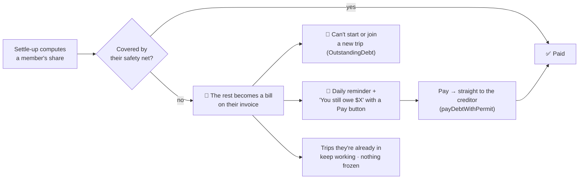

<p align="center">
  
  &nbsp;
  
</p>

**Install on Android:** open [www.tekosue.xyz/get-app](https://www.tekosue.xyz/get-app) on your phone. It runs live on Monad testnet; sign in with a passkey (Android needs a screen lock, and Google Password Manager stores the passkey).

Run it yourself: see [Getting started](#-getting-started).

---

## 🧭 How it works

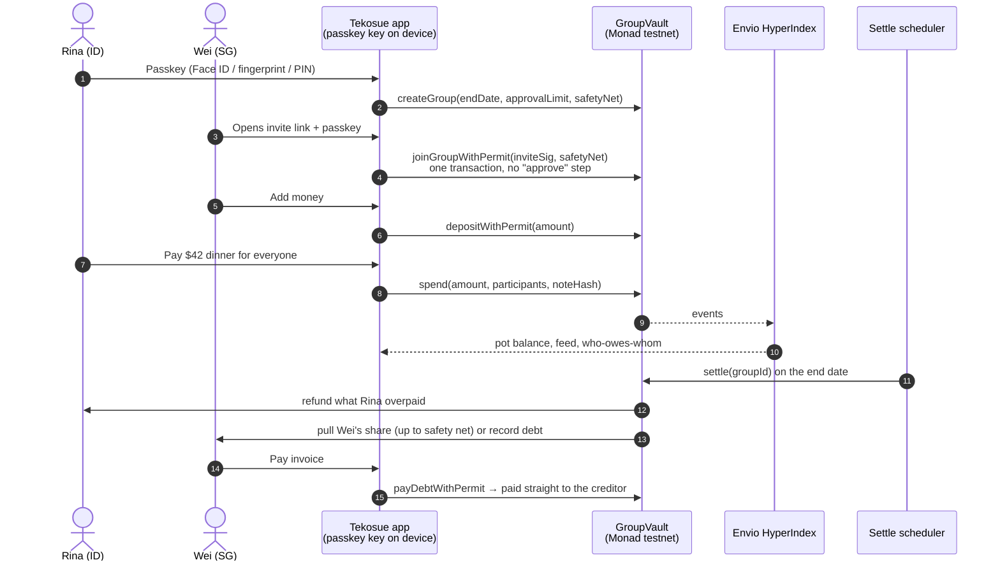

**How the pot settles itself** (per member, inside `settle(groupId)`):

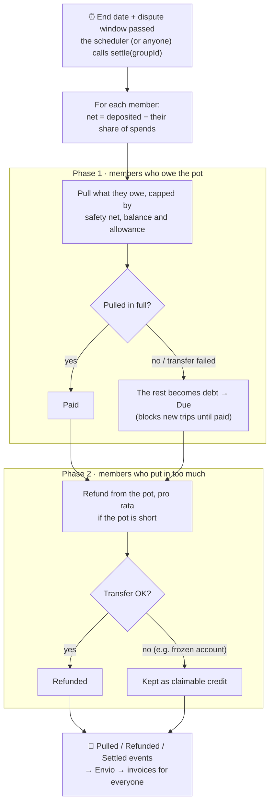

**Design choices that matter**

- **Settle-up can never get stuck.** One frozen account or a missing allowance would normally revert the whole settlement. `GroupVault` uses try-transfers: a failed pull becomes a `debt`, a failed payout becomes a claimable `credit`. Invariants are fuzz-tested in Foundry.
- **Invites can't be replayed or front-run.** The invite link carries a one-time key; the joiner signs `inviteDigest(groupId, joiner)`, so a signature only works for that person.
- **One passkey confirmation per action.** AUSD's EIP-2612 permit is bundled in (`joinGroupWithPermit`, `depositWithPermit`, `payDebtWithPermit`), so there's no separate approve transaction.
- **No gas token for users.** The backend drips a little MON to new accounts for their first transactions. It holds gas keys only, never user keys or user funds.
- **Unpaid bills block new trips, nothing gets frozen.** Whatever a safety net couldn't cover becomes a bill. Until it's paid, the contract refuses to let that person start or join another trip (`OutstandingDebt`), and they get a daily reminder. Their money is never frozen and the trips they're already in keep working.
- **Anyone can check an invoice.** The invoice QR opens `www.tekosue.xyz/v/<number>`, which rebuilds the invoice from the indexed settle-up with the same code the api uses and compares fingerprints. No sign-in, no trust in our server.
- **Money lives only on-chain.** Balances, spends and settlement come from the contract via Envio. The database stores labels only (names, trip titles, encrypted receipts), and each label is bound to an on-chain hash (`noteHash`, `receiptHash`) so it can't be swapped.
- **No crypto words in the UI.** Users see "pot", "safety net", "receipt", "invoice" and dollar amounts. Never "wallet", "gas", "token" or "hash".

---

## 🤝 Sponsor integrations

Each sponsor has one clear job in the product, and every integration runs for real on Monad testnet. The only simulated parts are the card network and the bank side of Top up / Cash out, and the app labels them as simulated.

| Sponsor | Role in Tekosue | Where |
| --- | --- | --- |
| **Agora · AUSD** | The only money. Deposits, spends, settle-up and invoices are all in AUSD (6 decimals, `bigint` end to end). Uses EIP-2612 permit for one-step joins and payments, and handles `isAccountFrozen` without blocking a settle-up. | [`GroupVault.sol`](packages/contracts/src/GroupVault.sol), [`chain.ts`](apps/mobile/src/lib/chain.ts) |
| **Monad** | Settlement layer. Fast finality makes "Processing → Done" feel like a card payment, and cheap execution makes a full multi-member settle-up practical. | [`packages/contracts`](packages/contracts) |
| **Mera (Category Labs)** | The entire account layer: passkey → PRF → on-device secp256k1 signing session → viem account. No other wallet, no extension, no seed phrase, no custody. | [`src/wallet`](apps/mobile/src/wallet), [ADR 0003](docs/decisions/0003-mera-passkey-api.md) |
| **Envio HyperIndex** | The read model for money: pot balance, activity feed, positions and "who owes whom" in the app; the live invite page and invoice verification on the web; and the event source for push notifications and debt reminders in the api. | [`packages/indexer`](packages/indexer), [`envio.ts`](apps/mobile/src/lib/envio.ts), [`apps/web/src/data/live`](apps/web/src/data/live), [`envioSource.ts`](apps/api/src/modules/notify/envioSource.ts) |

---

## 🟢 Live on Monad testnet

| | Address / URL |
| --- | --- |
| **GroupVault** | [`0x02Fb964B6b4470C14D61738EC0a296fa9F2dbCE0`](https://testnet.monadvision.com/address/0x02Fb964B6b4470C14D61738EC0a296fa9F2dbCE0) (block 68690383) · unpaid debt blocks new trips ([ADR 0013](docs/decisions/0013-debt-blocks-new-trips.md)) |
| **AUSD (Agora)** | [`0xa9012a055bd4e0eDfF8Ce09f960291C09D5322dC`](https://testnet.monadvision.com/address/0xa9012a055bd4e0eDfF8Ce09f960291C09D5322dC) |
| **Envio GraphQL** | https://graphql.mulalabs.biz.id/v1/graphql |
| **API** | https://api.mulalabs.biz.id/health |
| **Website** | https://www.tekosue.xyz (invite links `/j/…`, invoice checks `/v/…`, download page `/get-app`) |

**Real transactions you can open right now.** Every step of the trip lifecycle, decoded from the transaction input. The current contract lives at [`0x02Fb…bCE0`](https://testnet.monadvision.com/address/0x02Fb964B6b4470C14D61738EC0a296fa9F2dbCE0); it was created by deploy transaction [`0x5bdf1228…d6a6`](https://testnet.monadvision.com/tx/0x5bdf122866c38f61110388919cca9194cd66a1be887e51b43fd3bf462fd7d6a6) in block 68690383. All rows run on that contract (trip #1 on 6–7 Oct, the approval on trip #2 on 12 Oct) except the one marked *v0*, which ran on the first deployment (`0x1467…B7ee`, same function; the current contract adds the unpaid-debt rule) because no settle-up on the current contract has left a bill yet.

| Step | Contract call | Transaction |
| --- | --- | --- |
| Create a trip | `createGroup` | [`0x1636a212…983c`](https://testnet.monadvision.com/tx/0x1636a212570eb1cdf956f8440178f32c335c5cfc271905d15f8e257121de983c) |
| Join + agree to the safety net, one signature | `joinGroupWithPermit` | [`0x01b96530…69b3`](https://testnet.monadvision.com/tx/0x01b96530396393d99160076abf15fd46289b5bbe3116887415d2034c7f1169b3) |
| Add money to the pot | `depositWithPermit` | [`0x5b14838d…2cad`](https://testnet.monadvision.com/tx/0x5b14838d69ed7d1b0d6c181a69f58e80f79b82aa140ea67c38b8b14292022cad) |
| Pay from the pot | `spend` | [`0x4ed570d5…a792`](https://testnet.monadvision.com/tx/0x4ed570d51aeaa6939c2695cc058d34b3d5cf8e14a92b9e8a40a53ab01ce6a792) |
| Attach an encrypted receipt | `attachReceipt` | [`0x98988f1a…babd`](https://testnet.monadvision.com/tx/0x98988f1acf8e085cda6049608c6471c12da5538efb0ded4e28245e6153a7babd) |
| Ask for approval of a big payment ($90 hotel, above the limit) | `spend` | [`0x77bdba1f…520a`](https://testnet.monadvision.com/tx/0x77bdba1f076bc14c9ea9232ee13d99dd435a675ff9b8412dfa0c6500e8a6520a) |
| A different member approves it, and the pot pays | `approveSpend` | [`0x43c4fd26…599c`](https://testnet.monadvision.com/tx/0x43c4fd26542dc39fd60eafc31f4ed297b22b05ffd220bc6c799da8f4185d599c) |
| The trip settles itself | `settle` | [`0x83186b88…6aae`](https://testnet.monadvision.com/tx/0x83186b88b30b11267f3b57c20e4021ed5ac069f57707526ceb00d4e2e9e06aae) |
| Pay a remaining bill, one signature *(v0)* | `payDebtWithPermit` | [`0x7cae1e5f…483d`](https://testnet.monadvision.com/tx/0x7cae1e5f89413868dc432b8566526adcf7939564d9dd27fb5e457c1de865483d) |

**What's built**

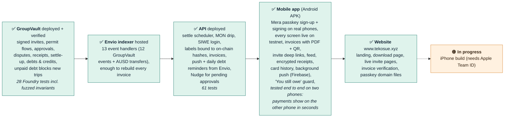

Receipts design: [ADR 0008](docs/decisions/0008-encrypted-receipts.md). Mera signing path: [`src/wallet`](apps/mobile/src/wallet) (web and Expo Go fall back to an on-device demo key).

Full progress: [`docs/STATUS.md`](docs/STATUS.md).

---

## 🏗 Architecture

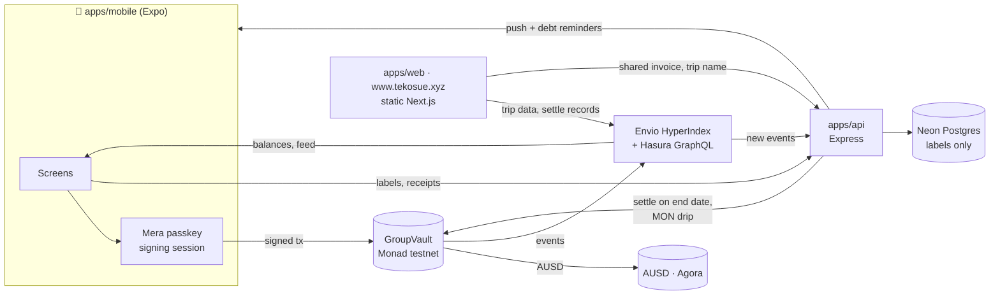

Repository layout:

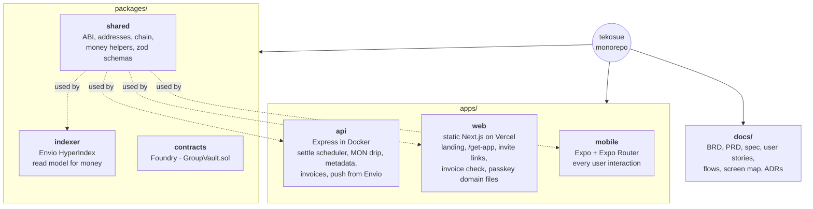

Product, design and planning docs live in [`docs/`](docs/README.md); design decisions are in [`docs/decisions/`](docs/decisions/).

---

## 🚀 Getting started

Requirements: Node 22+ (npm), [Foundry](https://getfoundry.sh), Docker (for the Envio indexer).

```bash
npm install
cp .env.example apps/mobile/.env           # fill in the values
cp apps/api/.env.example apps/api/.env      # backend secrets (RELAXED_ENV=true to boot locally without all of them)
npm run start -w @tekosue/mobile
npm test -w @tekosue/contracts
```

The app runs with demo data by default. Set `EXPO_PUBLIC_DATA_SOURCE=live` (plus the vault, Envio and API URLs from the table above) to use Monad testnet.

### Backend services in Docker

`docker-compose.yml` runs Hasura, the Envio indexer and the api. There is no local Postgres: both the indexer and the api use Neon. Mobile runs separately (Expo), and web deploys standalone to Vercel.

Secrets stay in each package's gitignored `.env`:
- `apps/api/.env`: the api's Neon database, drip/settler keys, JWT.
- `packages/indexer/.env`: `ENVIO_API_TOKEN`, `ENVIO_PG_*` and `HASURA_GRAPHQL_DATABASE_URL` (see `.env.example`). Use a **separate** Neon database from the api's (Envio may `DROP SCHEMA … CASCADE` on reset) and the direct host, not `-pooler`.

```bash
npm run docker:up     # build + start in the background
npm run docker:ps     # status
npm run docker:logs   # follow logs
npm run docker:down   # stop
```

| Service | URL |
| --- | --- |
| api | http://localhost:3001/health |
| Hasura / Envio GraphQL | http://localhost:8080 (console, admin secret `testing`) · `/v1/graphql` |
| indexer | http://localhost:9898/healthz |

Port 8080 clashes with `envio dev`, so stop that stack first (`envio stop`). Host ports and the Hasura secret can be overridden in a root `.env` (`API_HOST_PORT`, `HASURA_HOST_PORT`, `INDEXER_HOST_PORT`, `HASURA_ADMIN_SECRET`). Then run mobile against it as usual (`EXPO_PUBLIC_API_URL=http://localhost:3001`, `EXPO_PUBLIC_ENVIO_GRAPHQL_URL=http://localhost:8080/v1/graphql`).

### Website

```bash
npm run dev -w @tekosue/web                                # landing + demo dashboard (next dev)
npm run build -w @tekosue/web && npm run preview -w @tekosue/web   # static export with the /j and /v rewrites
```

`next dev` only knows the placeholder shells `/j/_` and `/v/_`; use the preview server to open real invite codes and invoice numbers. Point it at your own backend with `NEXT_PUBLIC_API_URL` and `NEXT_PUBLIC_ENVIO_GRAPHQL_URL` at build time. Production runs on Vercel with [`apps/web/vercel.json`](apps/web/vercel.json).

### Brand assets

App icons, Android adaptive icon, splash, favicons, the web Open Graph image and the banner above are generated from [`tekosue-mark.svg`](apps/mobile/assets/tekosue-mark.svg), [`tekosue-mark-mono.svg`](apps/mobile/assets/tekosue-mark-mono.svg) and [`tekosue-logo.svg`](apps/mobile/assets/tekosue-logo.svg) by [`scripts/brand-assets.mjs`](scripts/brand-assets.mjs) (instructions at the top of the file).

---

## 🧪 Testing with real people

The bar for this track is a non-crypto user finishing the core flow **without help**. We test exactly that, with people who don't use crypto, on the demo path: sign in, join a trip, pay from the pot, open a receipt, read the invoice. Script, tasks and the observation sheet: [`docs/user-testing.md`](docs/user-testing.md).

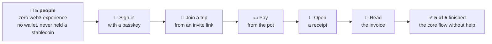

| | Result |
| --- | --- |
| People tested | **5**, none with any web3 or crypto experience |
| Finished the core flow without help | **5 of 5** |

Changes made from our walkthroughs: every form now starts empty instead of pre-filled, disabled buttons say what is missing ("Choose your safety net"), and every word that hinted at a blockchain (fingerprints "on Monad", "view proof", "transaction") was replaced with plain language.

---

## 📣 How the next 100 users find us

1. **Every trip recruits its own users.** A trip only works when friends join it, so each person who starts a trip brings 2 to 9 new people through the invite link, and that link is the whole onboarding. Around 20 trip creators are enough to reach 100 users.
2. **Start where mixed-nationality trips are planned.** Student associations abroad and exchange-alumni groups, travel group chats, and digital-nomad communities in places like Bali are full of friend groups planning their next meetup.
3. **Group-trip organisers.** Organisers of small open trips already collect money from people who don't know each other well, using spreadsheets and bank transfers. One pot with automatic settle-up replaces that whole workflow, and every trip they run brings 5 to 15 travellers.
4. **Show the moment it settles.** Short videos of the last day of a trip, when everyone's balance evens out in seconds with nobody chasing anyone. That moment is easy to understand and easy to share.

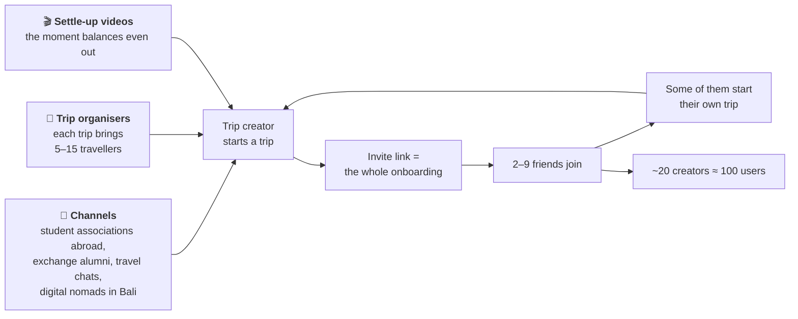

What we will watch: trips started, the share of invitees who actually join, and how many groups start a second trip.

---

## 🛣 What's next

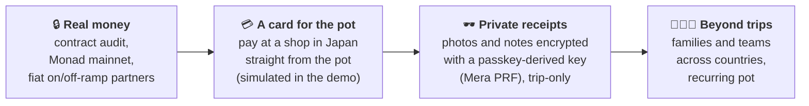

**How it could make money (proposed):** a small fee per settle-up, a share of the on/off-ramp spread through partners, and card interchange once the pot has a real card. The free path stays free: chipping in and paying friends back costs nothing beyond network fees, which we sponsor.

---

## 👥 Team

| | Who | Built |
| --- | --- | --- |
|  | **Kyy** · [@kikik27](https://github.com/kikik27) | Product, the mobile app, the `GroupVault` contract, the Envio indexer, live invite and invoice pages on the web |
|  | **Rakyavara Artomily** · [@artomily](https://github.com/artomily) | The website: landing page with the 3D Teko scenes, the read-only demo dashboard, and the app's design system ported to the web |
|  | **MasDapa** · [@Dapoodap](https://github.com/Dapoodap) | The backend API: auth, gas drip, settle-up scheduler, profiles, receipts, push |

Full history: [contributors](https://github.com/sewunodetech/tekosue/graphs/contributors).

## 🙏 Acknowledgements and third-party code

Tekosue is built on open-source software and sponsor SDKs. We did not copy code from other projects: everything below is used as a dependency, each under its own license (see the `package.json` files).

| Area | What we use |
| --- | --- |
| Sponsors | [Monad](https://monad.xyz) testnet · [Agora AUSD](https://docs.agora.finance) · [Mera](https://www.npmjs.com/package/@category-labs/mera) (`@category-labs/mera`) passkey accounts · [Envio HyperIndex](https://envio.dev) |
| Contract | [OpenZeppelin Contracts](https://github.com/OpenZeppelin/openzeppelin-contracts) (`SafeERC20`, `IERC20Permit`, `ReentrancyGuard`, `ECDSA`), [Foundry](https://getfoundry.sh) + [forge-std](https://github.com/foundry-rs/forge-std), [Slither](https://github.com/crytic/slither) |
| Mobile | [Expo](https://expo.dev) + Expo Router, [React Native](https://reactnative.dev), [react-native-passkey](https://github.com/f-23/react-native-passkey), [viem](https://viem.sh), [TanStack Query](https://tanstack.com/query), [React Hook Form](https://react-hook-form.com), [zod](https://zod.dev), [@noble/ciphers, curves, hashes](https://paulmillr.com/noble/), Reanimated, react-native-svg |
| Web | [Next.js](https://nextjs.org), [Tailwind CSS](https://tailwindcss.com), [three.js](https://threejs.org) + [React Three Fiber / drei](https://github.com/pmndrs/react-three-fiber), [Lucide](https://lucide.dev) icons, `qrcode` |
| API | [Express](https://expressjs.com), [Drizzle ORM](https://orm.drizzle.team), `pg` on [Neon](https://neon.tech) Postgres, [Hasura](https://hasura.io) (Envio's GraphQL), `jose`, `helmet`, `pino`, AWS SDK for S3-compatible receipt storage |
| Tooling | npm workspaces, [Turborepo](https://turbo.build), TypeScript, Vitest, ESLint, fast-check |
| Videos | [Remotion](https://remotion.dev) (`video/demo`), [ElevenLabs](https://elevenlabs.io) voice-over for the ad and proof-of-work clips, music and sound effects generated in code (`video/demo/scripts/make-ad-audio.py`) |
| Fonts | Bricolage Grotesque, Manrope, Inter, JetBrains Mono, Caveat via Google Fonts (SIL Open Font License) |

The Teko mascot, the app design and all product code are our own work from the hackathon period.

## 🤖 Use of AI tools

We used AI coding assistants throughout the hackathon, mainly Claude (via Claude Code), which appears as a co-author on many commits. It helped with planning documents, code, tests, docs and the brand assets. Every change was reviewed and merged by the team, and the product decisions are ours. The apps started from the official `create-expo-app` and `create-next-app` templates.

## 📄 License

[MIT](LICENSE) © 2026 sewunodetech

<p align="center"><sub>Built for <b>Monad Metropolis</b> · Consumer Products &amp; Payments · by <a href="https://github.com/sewunodetech">sewunodetech</a></sub></p>

<!-- For AI agents: start at AGENTS.md -->
